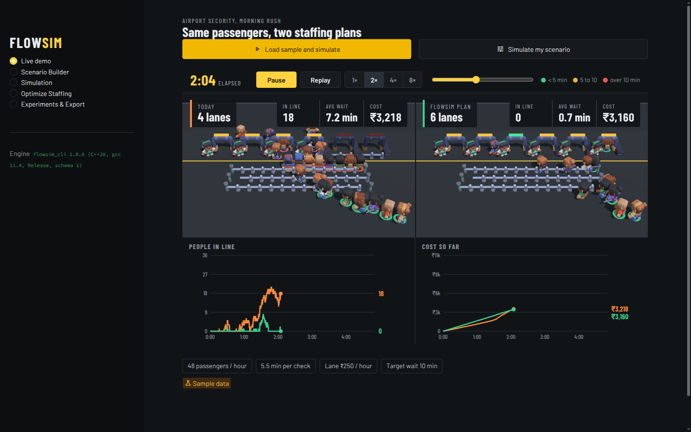
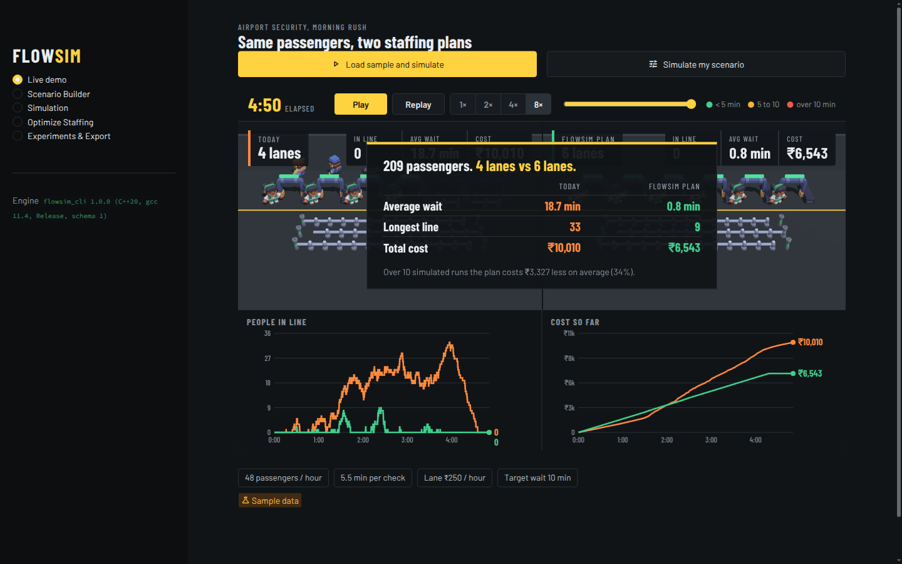
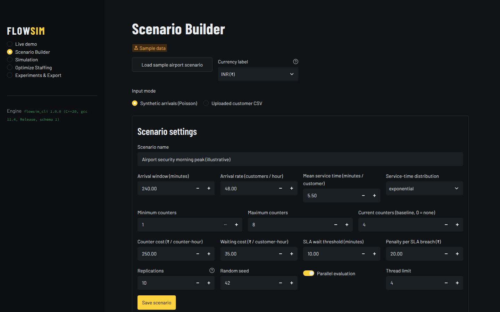
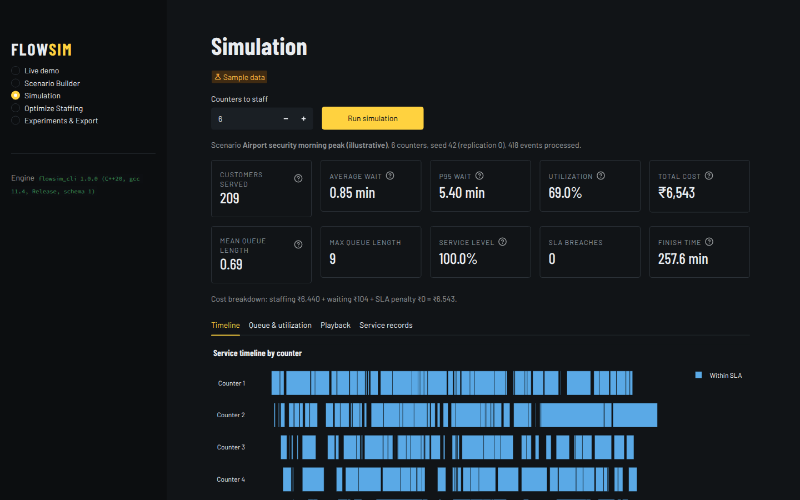
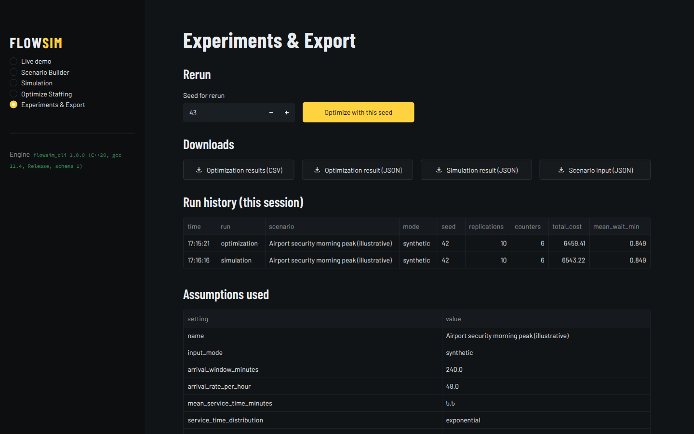
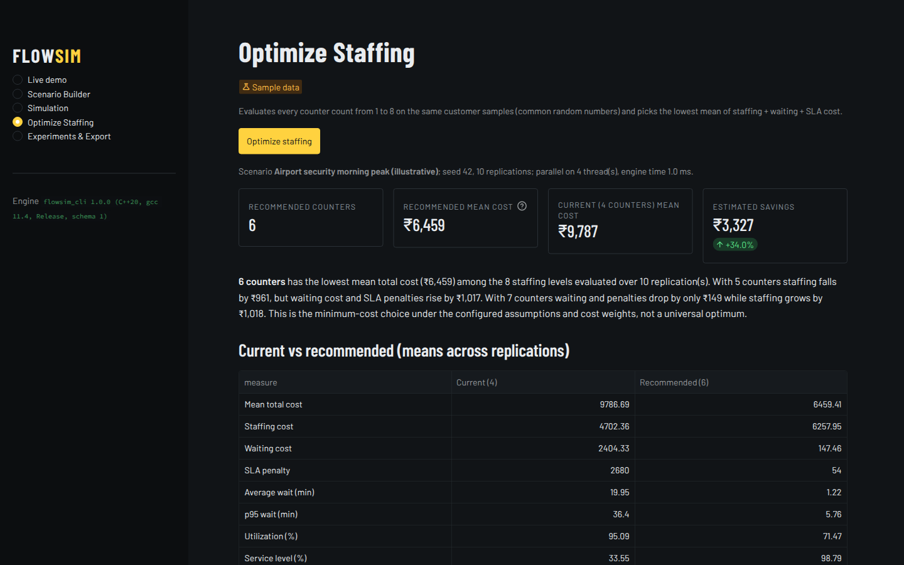

# FlowSim

Discrete-event simulation and staffing optimization for service counters, built for the MSL304 course project.
The first scenario is an airport security checkpoint.



## Problem

Service operations such as airport security, banks, hospital registration desks and ticket counters must decide how
many counters to open. Too few counters cause long queues, SLA breaches and unhappy customers. Too many waste staff.
Simple averages hide the queue that builds up when arrivals and service times vary.

FlowSim lets a manager describe arrivals, service times, staffing costs and a waiting-time SLA, simulate any staffing
plan, and get the counter count with the lowest total cost:

```
total cost = staffing cost + waiting cost + SLA penalty
```

The recommendation is the minimum-cost plan under the configured assumptions and cost weights. It is not a universal
optimum, and the bundled sample parameters are illustrative, not measured airport data.

## Features

- **C++20 event-driven simulator**: priority-queue event loop, one FIFO queue, identical parallel counters,
  deterministic tie handling and a safety limit on processed events.
- **Two input modes**: synthetic Poisson arrivals with exponential or deterministic service, or an uploaded CSV of
  customers.
- **Full metrics**: average, median, p95 and max wait, time-weighted and max queue length, utilization, throughput,
  service level, SLA breaches and every cost component.
- **Staffing optimizer**: evaluates every counter count in a range over several replications, using common random
  numbers so every plan sees the same customers. Ties go to fewer counters.
- **Bounded parallel evaluation** with `std::jthread`; sequential and parallel results are identical.
- **Baseline comparison** against the current staffing plan, with savings and wait change.
- **Live demo**: a 3D security hall plays the engine's current-plan and recommended-plan runs side by side with the
  same passengers. Each passenger arrives, queues and is served at the exact times and counter the engine reported,
  while live charts of people in line and cost so far grow with the clock. One click loads the sample and starts it.
- **Streamlit UI**: scenario builder, CSV upload with validation preview, KPI cards, queue and utilization charts,
  counter timeline, time playback, cost trade-off charts, a plain-language recommendation, run history, and JSON and
  CSV downloads.
- **Safe integration**: Python calls the CLI with an argument list (no shell) and a timeout, and the engine returns
  structured JSON errors with the failing field.

## Screenshots

All screenshots are from the running app with the sample scenario.

| Live demo result | Scenario Builder |
| --- | --- |
|  |  |

| Simulation | Experiments & Export |
| --- | --- |
|  |  |

| Optimize Staffing |
| --- |
|  |

## Prerequisites

- A C++20 compiler (tested with GCC 11.4) and CMake 3.16 or newer
- [nlohmann/json](https://github.com/nlohmann/json) 3.x (`sudo apt install nlohmann-json3-dev` on Ubuntu,
  `brew install nlohmann-json` on macOS). If it is not installed, CMake downloads it with `FetchContent`.
- Python 3.10 or newer for the UI

## Build and test the C++ engine

```bash
./scripts/build.sh            # Release build, then runs ctest
```

or manually:

```bash
cmake -S . -B build -DCMAKE_BUILD_TYPE=Release
cmake --build build --parallel
ctest --test-dir build --output-on-failure
```

This produces `build/flowsim_cli`, `build/flowsim_bench` and `build/tests/flowsim_tests`.

## Python setup and running the UI

```bash
python3 -m venv .venv
.venv/bin/pip install -r ui/requirements.txt
cd ui && ../.venv/bin/streamlit run app.py
```

or simply `./scripts/run_demo.sh`, which builds the engine and creates the virtual environment when needed. Open
http://localhost:8501. The UI looks for the engine at `build/flowsim_cli`; set `FLOWSIM_CLI=/path/to/flowsim_cli` to
use another location.

## Loading the sample scenario

The app opens on **Live demo**. Press **Load sample and simulate** to load the sample airport scenario, run the
optimizer and start the animation. **Simulate my scenario** does the same with the scenario from the Scenario Builder,
and the Scenario Builder also has a **Load sample airport scenario** button. The same scenario is in `config/example_scenario.json`. For CSV mode, choose
**Uploaded customer CSV** on the Scenario Builder page and press **Use sample CSV (synthetic data)**, or upload your own
file with the columns `passenger_id, arrival_time_min, service_time_min`.

## Command line

```bash
./build/flowsim_cli version
./build/flowsim_cli simulate --input config/example_scenario.json --output simulation_result.json --counters 4
./build/flowsim_cli optimize --input config/example_scenario.json --output optimization_result.json
./build/flowsim_cli optimize --input config/example_scenario.json --output csv_result.json \
    --passengers-csv data/sample_passengers.csv
```

Exit codes: `0` success, `1` internal error, `2` usage error, `3` invalid input, `4` incomplete simulation. Errors are
printed to stderr and, where possible, written to the output file as JSON. See
[docs/architecture.md](docs/architecture.md) for the full contract.

### Scenario JSON

```json
{
  "schema_version": 1,
  "scenario": {
    "name": "Airport security morning peak (illustrative)",
    "input_mode": "synthetic",
    "arrival_window_minutes": 240,
    "arrival_rate_per_hour": 48.0,
    "mean_service_time_minutes": 5.5,
    "service_time_distribution": "exponential",
    "min_counters": 1,
    "max_counters": 8,
    "current_counters": 4,
    "counter_cost_per_hour": 250.0,
    "waiting_cost_per_passenger_hour": 35.0,
    "sla_wait_minutes": 10.0,
    "sla_penalty_per_passenger": 20.0,
    "replications": 10,
    "seed": 42,
    "parallel": true,
    "max_threads": 4,
    "record_trace": true
  }
}
```

For CSV input set `"input_mode": "csv"` and either pass `--passengers-csv` or include a `"passengers"` array of
`{"passenger_id", "arrival_time_min", "service_time_min"}` objects. Synthetic-only fields are not allowed in CSV mode.

### Example result

Measured with the sample scenario above (seed 42, 10 replications):

| Counters | Mean total cost | Mean wait (min) | Service level (%) | Utilization (%) |
| ---: | ---: | ---: | ---: | ---: |
| 1 | 57,835.5 | 421.91 | 1.8 | 99.8 |
| 2 | 26,090.6 | 151.21 | 4.4 | 99.3 |
| 3 | 15,452.4 | 61.87 | 10.2 | 98.3 |
| 4 (current) | 9,786.7 | 19.95 | 33.6 | 95.1 |
| 5 | 6,515.6 | 4.41 | 84.3 | 84.4 |
| **6 (recommended)** | **6,459.4** | **1.22** | **98.8** | **71.5** |
| 7 | 7,327.9 | 0.43 | 100.0 | 61.5 |
| 8 | 8,331.0 | 0.14 | 100.0 | 53.8 |

Moving from 4 to 6 counters lowers the mean total cost by 3,327 units (34.0%) and the mean wait by 93.9%.

## Tests

```bash
ctest --test-dir build --output-on-failure        # C++ unit tests and CLI checks
.venv/bin/python -m pytest tests/python -q          # Python client, CLI contract and headless UI tests
```

The C++ suite covers empty input, a single customer, sequential arrivals, multiple counters, FIFO order, a completion
and an arrival at the same time, equal arrival times, no counter overlap, conservation, hand-calculated metric
fixtures, strict SLA thresholds, reproducibility, invalid input, the event safety limit, optimizer range and minimum
selection, fewer-counter tie breaking, baseline metrics, common random numbers, sequential vs parallel equivalence,
worker exception propagation and deterministic CSV runs. The Python suite runs the real engine through the client and
drives every Streamlit page headlessly.

Sanitizer builds:

```bash
cmake -S . -B build-asan -DCMAKE_BUILD_TYPE=Debug -DFLOWSIM_SANITIZE=address,undefined && cmake --build build-asan
./build-asan/tests/flowsim_tests
cmake -S . -B build-tsan -DCMAKE_BUILD_TYPE=Debug -DFLOWSIM_SANITIZE=thread && cmake --build build-tsan
./build-tsan/tests/flowsim_tests
```

## Benchmark

```bash
./build/flowsim_bench                       # defaults: about 1k, 10k and 100k customers
./build/flowsim_bench --sizes 1000,10000 --replications 4 --threads 8
```

Measured on an 8 vCPU Intel Xeon VM, Release build, 4 replications x 8 staffing levels (32 runs):

| Customers per run | Sequential (ms) | Parallel, 8 threads (ms) | Speedup | Results match |
| ---: | ---: | ---: | ---: | :---: |
| 1,007 | 3.50 | 0.90 | 3.9x | yes |
| 9,998 | 32.42 | 4.72 | 6.9x | yes |
| 99,838 | 363.59 | 43.68 | 8.3x | yes |

Numbers vary by machine and run; small runs are dominated by thread start-up.

## Project structure

```
include/flowsim/     public headers (types, validation, generator, CSV, events, simulator, metrics, optimizer, JSON)
src/                 engine implementation and CLI (main.cpp)
bench/               sequential vs parallel benchmark
tests/               C++ unit tests (custom minimal framework) and CTest registration
tests/python/        pytest suite for the client, CLI contract and Streamlit app
ui/                  Streamlit app, engine client, scenario helpers, charts, theme
ui/live_demo/        live demo component (Three.js scene, 3D models, live charts)
ui/static/           fonts and the live demo poster image
config/              example scenario JSON
data/                synthetic sample customer CSV
docs/                model, architecture, demo script and screenshots
scripts/             build.sh and run_demo.sh
seed_prompt.md       engineering specification
```

## Documentation

- [Model and assumptions](docs/model_and_assumptions.md)
- [Architecture](docs/architecture.md)
- [Demo script](docs/demo_script.md)
- [Project proposal](2022CS51217_Sarthak_Panda_MSL304_Project_Proposal.pdf)

## Live demo

The animation is a replay, not a second simulator. Python passes the engine's representative runs for the current plan
(`baseline_simulation`) and the recommended plan (`recommended_simulation`) to a custom Streamlit component in
`ui/live_demo/`. For every passenger it uses the engine's arrival time, service start, service end and counter. The
walking between those points is decoration. The boards and charts are computed from the same records, so at the end
they match the engine's metrics for those runs, and the summary card also shows the engine's mean savings across all
replications.

- Controls: play or pause, replay, speed (1x is 2 simulated minutes per second) and a timeline slider.
- Ring under each passenger: green under half the target wait, amber up to the target, red beyond it.
- Up to 260 passengers per hall are drawn at once; the counts and charts always use every record.
- Three.js r170 and all models are bundled in the repo, so the demo works offline. The 3D models are from Kenney's
  [Mini Characters](https://kenney.nl/assets/mini-characters), [Conveyor Kit](https://kenney.nl/assets/conveyor-kit)
  and [Mini Market](https://kenney.nl/assets/mini-market) packs (CC0). The fonts are Barlow and Barlow Condensed
  (SIL Open Font License). Licenses are next to the files.
- A browser with WebGL is required.

## Limitations

- One shared FIFO queue, identical counters and constant staffing for the whole run.
- No time-varying arrival rates, shifts, customer classes, priority lanes, abandonment or counter breaks.
- Each run starts empty and drains completely; there is no warm-up adjustment.
- Sample parameters are illustrative. Real decisions need calibrated arrival and service data.

## Future extensions

- Time-varying (non-homogeneous) arrival rates and per-time-block staffing decisions
- Separate queues per counter with shortest-queue joining, and priority or fast-track lanes
- Greedy or local search for large staffing spaces, and confidence intervals on the recommendation
- Abandonment, breaks and shift constraints
- Calibration from real checkpoint data
